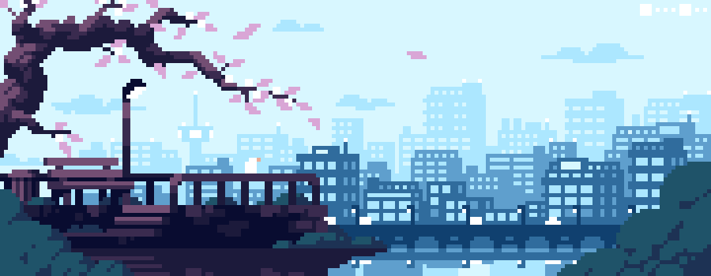

  

<h1 align="center">Hi, I'm Ines</h1>

  
  

  

---

## About me

I'm a second-year computer science student at **ESI-Alger**. I learn best by building things and poking at how they work, so most of what's on this page started as "what if I tried this?"

- Studying computer science (Informatique) at ESI-Alger
- Learning Git, frontend, backend and deployment so my projects actually live on the internet
- Curious about networking and cybersecurity
- Exploring smart contracts with Solidity
- Goal: a GitHub full of projects that are mine, not tutorial copies

---

## Tech I know

  

  

| Area | What I use |
|---|---|
| Programming | Python, JavaScript |
| Web | HTML, CSS (and growing) |
| Blockchain | Solidity |
| Networking | CCNA-level knowledge |

---

## Projects

### Resident Evil: Greenhouse

A small horror shooter I built in Python with pygame for the Shellmates welcome day. You aim and shoot a plant mutant with your **bare hand** through the webcam: point your finger to aim, raise your thumb and drop it to fire. It uses MediaPipe for hand tracking and falls back to mouse mode if there's no camera.

More coming soon.

---

## Currently working on

- Getting comfortable with Git and GitHub workflows
- Leveling up my frontend skills
- Starting on backend and deployment
- Planning more unique projects to fill this profile

---

## GitHub stats

  
  

---

## Let's connect

I love meeting people who are into code, security, or blockchain. Come say hi on [LinkedIn](https://www.linkedin.com/in/ines-bedad-12111035b/).

  

